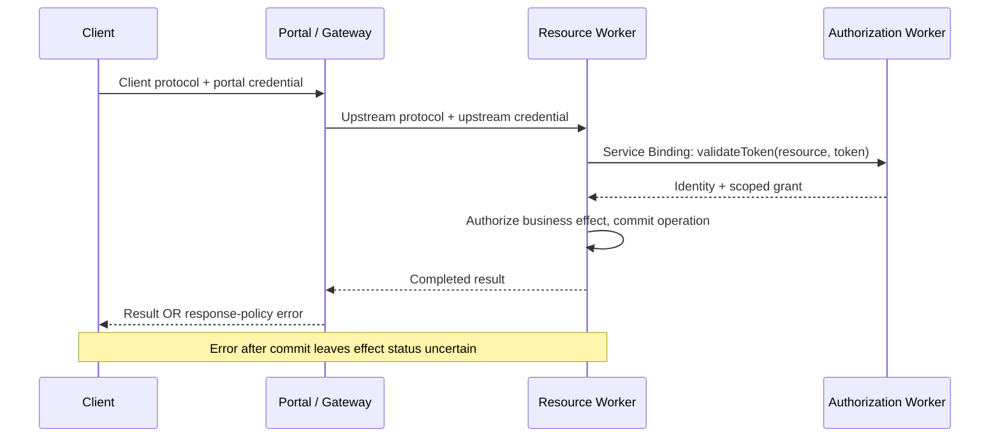

# Cloudflare authorization and proxy paths

Base: `2026-07-28` / explicit host compatibility. Extension/spec: `Workers OAuth Provider v1; Portal docs observed 2026-10-15`. Assessed: `2026-10-15`.

Use for shared Workers login or a Portal-mediated failure. A simple single service can retain combined `OAuthProvider`; split only when multiple resource Workers need a shared authorization owner.

## Integration

`OAuthAuthorizationServer` owns login/token issuance; each `OAuthResourceServer` owns a distinct resource URL, audience and scopes. Bind `AUTH_SERVER` to the authorization Worker's named `WorkerEntrypoint` and call `validateToken(resource, token)`. Shared login does not imply a shared audience. Read the installed dependency's `skills/migrate-to-1.0/SKILL.md`, types and official split example first. Verify metadata, 401 challenge, correct/wrong resource tokens and effect permissions.

The announcement's POST check is a simplified example. MCP read tools also use POST. Decode the actual call, classify the business effect and enforce scope before dispatch. This observation is not evidence of an OAuth library vulnerability.

Documented path; the local fixture reproduces the response-blocking seam.



## Positive example and counterexample

The Lab tests read/write calls that both use POST. Record protocol, credential owner/audience and destination for client→Portal and Portal→upstream separately. A July client does not prove a migrated upstream.

Gateway may block an upstream response. Inference from that ordering: client failure does not establish absence of an effect. Execute once, block the response, retry with the same business operation identity and observe one effect; an unsafe control duplicates it. Bind identity to principal/resource/action and payload; changed payload conflicts. Production requires atomic durable business storage; the in-memory fixture does not prove cross-process behavior.

Run the local positive/counterexample lane from the repository root; inspect its [fixture source](../../lab/tests/support/cloudflare-deployment-seam.ts) and [runner](../../lab/scripts/run-lab-fixtures.ts).

```bash
cd lab
npm run test:fixtures
```

## Evidence ceiling

The fixture deploys nothing and does not test the real OAuth library or DLP. Consider Code Mode for large catalogs, composition or intermediate filtering; keep simple domain tools when adequate. Portal currently excludes upstream servers with their own Code Mode enabled: select their full-tool endpoint/opt-out or disable Portal Code Mode. Compare task completion, errors and recovery cost rather than tool count.

Sources:

- <https://developers.cloudflare.com/changelog/post/2026-10-01-workers-oauth-provider-1x/>
- <https://developers.cloudflare.com/changelog/post/2026-08-25-mcp-portals-mcp-2026-07-28/>
- <https://developers.cloudflare.com/cloudflare-one/access-controls/ai-controls/mcp-portals/>
