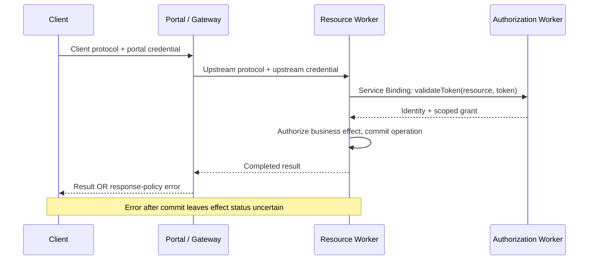

# Cloudflare 授权与代理路径

Base: `2026-07-28` / explicit host compatibility. Extension/spec: `Workers OAuth Provider v1; Portal docs observed 2026-10-15`. Assessed: `2026-10-15`.

适用于 Workers MCP 共享登录或 Portal 多跳排错。只有一个简单服务时，保留合并式 `OAuthProvider` 即可；多个 resource Workers 确实需要共享登录时，再考虑拆分授权服务。

## 接法

`OAuthAuthorizationServer` 负责登录和发 token，`OAuthResourceServer` 在各自 resource URL 校验 audience、scope。用 `AUTH_SERVER` Service Binding 指向授权 Worker 的具名 `WorkerEntrypoint`，通过 `validateToken(resource, token)` 校验；不要把同一登录服务误当作所有 resource 共用 audience。先读所装依赖附带的 `skills/migrate-to-1.0/SKILL.md`、类型与官方 split example，再改配置。验证 resource metadata、401 challenge、正确／错误 resource token 和业务权限。

公告中的 POST 判断仅是简化示例。MCP 读工具也通过 POST 发送；在实际 call 解码后按 tool 和业务效果判 scope，在 effect 前拒绝未授权操作。不能据此声称 OAuth 库有漏洞。

文档描述的路径；本地 fixture 复现响应阻断这一接缝。



## 正向例子与反例

Lab 用同为 POST 的读写 call 检查 scope。代理样本分别记录 client→Portal 和 Portal→upstream 的协议、凭据 owner/audience 与目标；前端使用七月协议不证明后端已迁移。

Gateway 可以阻断上游结果。由响应阶段顺序可推导：客户端错误不足以证明 effect 未发生。样本先执行、再阻断响应，然后以相同业务 operation identity 重试，应仅产生一次效果；无去重的反例会执行两次。identity 要绑定 principal/resource/action 与 payload，换 payload 必须冲突。生产需要原子、持久的业务存储；本地内存样本不提供跨进程保证。

从仓库根目录运行本地正向／反例；可检查[fixture 源码](../../lab/tests/support/cloudflare-deployment-seam.ts)及[执行入口](../../lab/scripts/run-lab-fixtures.ts)。

```bash
cd lab
npm run test:fixtures
```

## 证据边界

样本不部署 Cloudflare、不验证 OAuth 库或真实 DLP。Code Mode 适合大量工具、组合调用及返回前过滤；少量领域工具可以保持原接口。Portal 当前不支持上游同时启用自己的 Code Mode，需选择 full-tool endpoint／opt-out 或关闭 Portal Code Mode。按任务完成、错误与恢复成本评价，不能只数工具。

官方来源:

- <https://developers.cloudflare.com/changelog/post/2026-10-01-workers-oauth-provider-1x/>
- <https://developers.cloudflare.com/changelog/post/2026-08-25-mcp-portals-mcp-2026-07-28/>
- <https://developers.cloudflare.com/cloudflare-one/access-controls/ai-controls/mcp-portals/>
